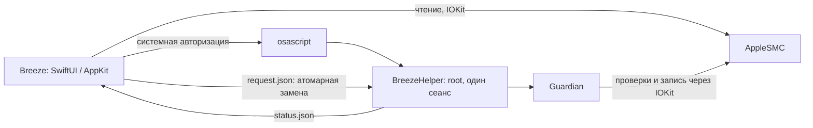

# Архитектура

[На главную](../README.md)

## Процессы



`Breeze` работает с правами пользователя. `WidgetModel` обновляет UI на главном потоке. Объект чтения SMC используется только в последовательной `sensorQueue`. Примерный период опроса — одна секунда; история содержит до 45 успешных температурных измерений.

При первом изменении параметров приложение запускает `/usr/bin/osascript`, который вызывает вложенный `BreezeHelper` через системный механизм `do shell script … with administrator privileges`. Пароль не передаётся в аргументах и не поступает в Breeze. Тайм-аут AppleScript — 86400 секунд; ограничения ручного сеанса задаются независимо в Guardian.

Помощник не регистрирует LaunchDaemon/LaunchAgent и не устанавливается отдельно. Глобальная `flock`-блокировка `/var/run/breeze.guardian.lock` не позволяет одновременно управлять вентиляторами двум помощникам Breeze. Другие приложения эта блокировка не ограничивает.

## Жизненный цикл сеанса

1. UI создаёт временную папку `breeze-<UUID>` с правами `0700`, `status.json` и начальную команду.
2. Во время авторизации и сеанса UI примерно раз в секунду обновляет `request.json` атомарной записью.
3. Помощник открывает папку, проверяет владельца и права, открывает статусный файл и соединение SMC.
4. Примерно раз в 500 мс проверяет PID UI, команду, время, телеметрию и Guardian.
5. Новая `revision` вызывает применение всех текущих целей; heartbeat сам по себе не продлевает срок.
6. При завершении или ошибке восстанавливает только затронутые сеансом вентиляторы. Явная команда авто может затронуть выбранный вентилятор, настроенный другой программой.
7. При временной ошибке восстановления повторяет попытки каждые две секунды, пока восстановление не подтвердится. UI при обычном выходе ожидает завершения помощника.
8. UI удаляет временную папку после завершения процесса авторизации/помощника. При аварии UI папка может остаться до очистки системой.

## Файловый протокол

Это внутренний протокол без гарантии стабильности; сторонний клиент не поддерживается.

Пример `request.json`:

```json
{
  "heartbeat": 1800000000.0,
  "revision": 1,
  "issuedAt": 1800000000.0,
  "targets": {"0": 2400, "1": -1},
  "stop": false
}
```

| Поле | Назначение |
| --- | --- |
| `heartbeat` | Unix-время последнего обновления команды, секунды |
| `revision` | Номер изменения настроек; при изменении команда применяется заново |
| `issuedAt` | Unix-время применения; срок заканчивается не позднее чем через 900 секунд |
| `targets` | Канонический строковый индекс вентилятора → RPM; `-1` означает авто |
| `stop` | Немедленное восстановление и завершение сеанса |

Отсутствующие ключи в исходной команде не затрагивают вентилятор. Штатный UI объединяет последующие изменения с текущим набором целей, не удаляя их молча. Индексы и обороты проверяются до первой записи.

`status.json` содержит `revision`, `active`, `message`, `timestamp`. Он обновляется на месте через заранее открытый дескриптор. Читатель может попасть на промежуточное содержимое; UI игнорирует неразбираемый JSON и пробует снова на следующем тике. Это не двусторонний транзакционный канал с подтверждением каждого heartbeat.

Оба файла ограничены 16384 байтами, должны быть обычными файлами, принадлежать указанному пользователю и иметь одну жёсткую ссылку. Открытие идёт через `openat` относительно дескриптора папки с `O_NOFOLLOW`; папка также открывается без следования конечному симлинку.

## SMC и мост C

`SMCBridge.c` использует `IOServiceOpen` для `AppleSMC` и `IOConnectCallStructMethod` с селектором 2. Компилятор проверяет размер пакета 80 байт и смещение массива байтов 48. Поддерживаются числовые типы `flt `, `fpe2`, `sp78`, `ui8 `, `ui16`, `ui32`; запись ограничена float, fpe2 и ui8.

| Ключ | Использование |
| --- | --- |
| `FNum` | Количество вентиляторов, от 1 до 8 |
| `F<n>Ac` | Фактические обороты |
| `F<n>Mn`, `F<n>Mx` | Аппаратные пределы |
| `F<n>Tg` | Целевые обороты |
| `F<n>Md` | Режим: 1 трактуется как ручной; остальные значения — как не ручные |
| `#KEY` | Число ключей SMC |
| Команда индекса 8 | Перебор имён ключей для поиска температур |

Для ручной скорости сначала делается попытка предварительной записи цели, затем запись режима 1 и повторная запись цели. До десяти раз с интервалом 50 мс перечитываются режим и цель; допустимое расхождение цели — менее 60 RPM. Для возврата записывается режим 0, затем проверяется, что он больше не равен 1. Эти проверки не доказывают, что вентилятор уже физически достиг заданных оборотов.

## Выбор температуры

При первом обращении перебираются доступные ключи `T*`; принимаются конечные значения от 0 до 125 °C, не включая границы. Если найдены `Tp*`, `Tg*` или `TC*`, используется эта группа; иначе — все найденные температуры. Показывается максимум. При последующих опросах требуется не меньше `max(1, число_ключей / 2)` допустимых показаний с целочисленным делением. Отказ отдельного датчика может остаться незамеченным, если этот порог выполнен.

Интерфейс SMC и значение ключей не являются публичным контрактом Apple; совместимость ограничивается фактическими проверками.

## Настройки и окно

Домен предпочтений — `local.breeze.widget`. `tileAlwaysOnTop` хранит выбор слоя, `BreezeDesktopTile` используется как имя AppKit autosave положения. Изначально плитка размещается у левого верхнего края доступного экрана.

Окно — прозрачная `NSPanel` без рамки. Уровень плитки вычисляется как `desktopIconWindow + 1`; поверх обычных окон она поднимается только в плавающем режиме. Поведение Spaces задаётся `canJoinAllSpaces`, `stationary`, `ignoresCycle`. Подробнее об этих системных механизмах: [NSWindow.CollectionBehavior](https://developer.apple.com/documentation/appkit/nswindow/collectionbehavior-swift.struct) и [CGWindowLevelKey](https://developer.apple.com/documentation/coregraphics/cgwindowlevelkey).
